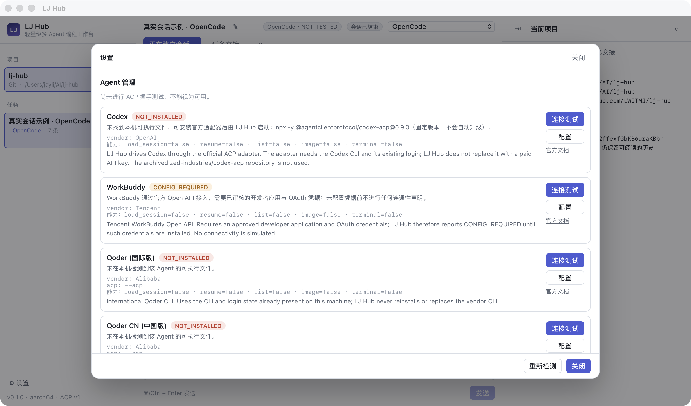

# LJ Hub

轻量级、多 Agent、统一编程工作台（macOS Apple Silicon 优先）。

**LJ Hub 不是一个新的大模型客户端内核**，它做的是：用统一的界面和统一的 ACP 运行核心，
驱动你已经安装并在用的多个编程 Agent，并让"换一个 Agent 接着干"这件事有据可依。

> English summary at the bottom of this file.

---

## 它现在真的能做什么

以下都是本机实测结果，不是设计稿：

- 真实 ACP 会话：启动 Agent 进程 → `initialize` 握手 → `session/new` → `session/prompt` →
  流式消息 / 思考 / 工具调用 / 计划 → `session/cancel` 取消 → 结束原因回收。
- **已用真实 Agent 跑通一轮真实模型任务**：OpenCode v2.0.30 通过 LJ Hub 返回了真实回答
  （`stop_reason = end_turn`）。
- DeepSeek Harness（`dsh acp`）真实握手成功，报告 `AVAILABLE`。
- 真实 Git 状态：分支、HEAD、未提交改动、未跟踪文件、单文件 diff（只读命令，见下方安全说明）。
- 任务交接三阶段：`PREPARED` → 接收方按当前仓库重新核验 → `ACCEPTED`；
  核验不通过则 `REFUSED`，重复验收不会产生第二个"有效拥有者"。
- 重要产物登记：路径、大小、SHA-256（可校验内容是否变化）。**登记不等于备份**。
- 权限请求：Agent 请求授权时界面阻塞等待，拒绝后不会继续执行（有自动化测试逐字校验）。
- 本地优先持久化：会话与历史保存在本机 JSON 文件（原子写入），重开应用后可继续阅读。

## 自动接力（多 Agent 协作）

这是本项目的核心目标：**你只向一个 AI 交代任务，它调用其他已安装的 Agent 去做，
彼此自动交接，不需要你在多个软件之间复制提示词。**

在应用里打开左侧「🔗 协作接力」：

1. 填任务目标，选规划 Agent → **生成计划**（规划 Agent 输出 JSON 计划，LJ Hub 严格校验：
   未知 Agent、依赖环、重复 id、循环/重试上限）。
2. **开始自动接力**。之后每一步都由调度器驱动，无需人工：
   执行 Agent 干活 → 生成交接资料 → LJ Hub 按当前仓库自检（HEAD / 未提交 / **内容指纹**）
   → 验收 Agent 独立验收 → 不通过就带着**具体的验收问题**自动返工 → 通过后进入下一步。
3. 达到循环/重试上限、Agent 无法运行、工作区漂移时，运行会停成「需人工」并保留原始错误，
   你在同一界面选择重试 / 标记完成 / 放弃。

保证（都有自动化测试）：

- **不需要人工复制**：步骤之间的上下文由 LJ Hub 组合成提示，含硬性用户要求（**永不截断**）
  与上游产出的有界上下文（截断处有可见标记）。
- **不互相覆盖**：全局一次只允许一个写入步骤；可选在独立 Git worktree + 独立分支中执行，
  主工作区有未提交改动时拒绝创建隔离区。
- **不误判完成**：中断的步骤不会被当成成功，也不会被盲目重跑，而是交人工确认。
- **不伪造能力**：握手成功 ≠ 能跑真实回合。真实回合失败（例如缺 API key）的 Agent
  会被标记并停止调度，界面显示供应商原文错误。

真机实测：OpenCode 真实执行 + 真实独立验收通过，运行自动完成；
DeepSeek Harness 验收入口因缺少 `DEEPSEEK_API_KEY` 停为「需人工」。
细节与对照审计见 [`docs/RELAY_AUDIT_AND_DESIGN.md`](docs/RELAY_AUDIT_AND_DESIGN.md)。

## 它明确不做什么

- 不伪装连接：命令存在 ≠ 可用。没有通过 ACP 握手的 Agent 一律标记 `NOT_TESTED`。
- 不伪造 WorkBuddy 连通性：没有官方审核凭据时状态是 `CONFIG_REQUIRED`。
- 不上传你的密钥、聊天记录、项目源码；不修改、迁移、覆盖你已有的 AI 工作区文档。
- 不自动下载不可信第三方程序；不默认运行 `npx latest`。
- 不做手机端、云端账号、多机调度、插件市场、完整 IDE、自研协议栈（见"第一版范围"）。

---

## 安装与运行

### 环境要求

- macOS 12 或更高（Apple Silicon 优先，Intel 亦可编译）
- Node.js ≥ 20、npm
- Rust 稳定版（`rustup` 安装）与 Xcode Command Line Tools
- `git` 命令行（用于 Git 状态、diff、交接证据）

### 从源码构建

```bash
git clone https://github.com/LWJTMJ/lj-hub.git
cd lj-hub
npm install
npm run tauri build -- --bundles app
```

产物：`src-tauri/target/release/bundle/macos/LJ Hub.app`

开发模式（Vite + Tauri 热更新）：

```bash
npm run tauri dev
```

> **签名与公证**：本仓库的构建流程未使用 Apple Developer 签名，也**未做公证**。
> 因此首次打开会被 Gatekeeper 拦截：右键 → 打开，或
> `xattr -dr com.apple.quarantine "/Applications/LJ Hub.app"`。
> 请不要把未签名构建当作已签名分发包。

### 应用数据位置

```
~/Library/Application Support/com.ljhub.desktop/
├── state.json              # 项目、任务索引、设置
├── tasks/<task>.json       # 每个任务的消息与交接资料
└── credentials/workbuddy.json   # 仅当你自己配置 WorkBuddy 凭据时创建（权限 0600）
```

---

## Agent 支持状态（本机实测，2026-10-16）

状态含义：`AVAILABLE` 真实握手通过；`NOT_INSTALLED` 本机无 CLI；
`AUTH_REQUIRED` Agent 声明需要登录；`CONFIG_REQUIRED` 缺少外部授权/凭据；
`UNSUPPORTED` 协议层不支持；`ERROR` 可执行存在但失败；`NOT_TESTED` 尚未验证。

| Agent | 状态 | 实际证据 |
|---|---|---|
| **OpenCode** | `AVAILABLE` | `opencode acp` 握手成功（agentInfo `OpenCode 2.0.30`）；**真实模型回合已通过**，并作为执行方与验收方完成过一次真实自动接力 |
| **DeepSeek Harness** | `AVAILABLE`（握手） | `dsh acp` 握手成功（`deepseek-harness-acp 0.0.1`）；**真实模型回合失败**：`no API key for provider route "deepseek-official"`。LJ Hub 据此把它标记为不可用于自动接力，直到提供 `DEEPSEEK_API_KEY`（可在 Agent 设置里填变量名，值只在启动时从环境读取，不落盘） |
| **Codex** | `NOT_INSTALLED` | 本机无 `codex-acp`，也无 Codex CLI；接入走官方 `@agentclientprotocol/codex-acp`，需你在设置中显式启用（固定版本，非 latest） |
| **WorkBuddy** | `CONFIG_REQUIRED` | 官方 Open API 适配器已实现并有协议测试（含 mock HTTP 服务），但需要开放平台审核通过的第三方应用 + OAuth 凭据 |
| **Qoder（国际版）** | `NOT_INSTALLED` | 本机装有 Qoder.app，但 `qoder` CLI 不在 PATH，未安装则不做任何声明 |
| **Qoder CN（中国版）** | `NOT_INSTALLED` | 本机装有 Qoder CN.app，但 `qodercn` CLI 不可用 |
| **TRAE** | `NOT_INSTALLED` | 本机装有 Trae CN.app，但 `traecli` 不可用 |
| **CodeBuddy Code（兼容入口）** | `NOT_INSTALLED` | 独立兼容入口，**不代表 WorkBuddy 已接入** |

`AVAILABLE` 之外的条目不会被当作可用；界面会直接说明原因。

### 配置某个 Agent

1. 打开「设置 → Agent 管理」。
2. 若显示 `NOT_INSTALLED`：填「可执行文件」为绝对路径，或勾选"允许固定版本 npx 适配器"（仅 Codex 有官方适配器）。
3. 点「连接测试」——这一步真的会启动该 Agent、跑一次 ACP `initialize` 并回收结果。
4. 只有测试通过（或明确报出 `AUTH_REQUIRED`）才会更新状态。

### WorkBuddy 接入说明

LJ Hub 实现了官方 Open API 适配器，覆盖文档中的：认证授权（OAuth 2.1 授权码 + 刷新）、
个人资料、本地助理（在线状态 / 发送消息 / 消息历史）、云端任务（创建 / 列表 / 查询，返回 ACP link）。
接口形态来自 <https://open.workbuddy.cn/docs/openapi>。

- 授权码换票属于**机密客户端**流程（需要 `client_secret`）。LJ Hub 不在客户端内置任何密钥；
  你可以在本机凭据文件中配置自己的应用密钥（文件权限 0600），或改由你自建后端完成换票。
- 未配置凭据时状态是 `CONFIG_REQUIRED`，LJ Hub 不会发出任何"已连接"的声明。
- ACP token 不会写入界面、日志或存储（有测试断言序列化结果不含 token）。
- 云端任务的 ACP 通道是 SSE + POST 双通道，属于后续工作，v0.1 未实现，标记为未支持。

---

## 任务交接（跨 Agent 继续工作）

目标不是共享模型内部状态（做不到，也不假装能做到），而是让接手方**有据可依**：

1. **PREPARED** — 发送方生成资料：目标、有效要求（可从既有文档只读导入）、禁止事项、
   已完成、重要决策、失败尝试、当前 Git 证据（HEAD / 分支 / 未提交改动）、
   重要产物（路径 / 大小 / SHA-256）、未完成项、下一步。
2. **VERIFIED** — 接收方实际核验：工程位置、Git HEAD 是否漂移、工作区是否漂移、
   登记产物是否存在且内容一致、资料是否足够继续。
3. **ACCEPTED** — 全部通过才接手；任一项不通过 → `REFUSED` 并记录原因。
   重复验收会被拒绝，不会出现两个有效拥有者。

同一项目可以有多个 Agent 会话，但**不会把一个 Agent 的原生 session id 当作另一个 Agent 能直接恢复的会话**。
原生会话恢复只在 Agent 自己声明 `session/load` 能力时才尝试，并如实记录成功或失败；
失败时保留可阅读的历史，并明确写"未恢复"。

## 与你现有 AI 体系的关系

LJ Hub v0.1 对既有文档（如 `USER_REQUIREMENTS.md`）只做**只读**导入与引用：
读取内容、计算 SHA-256、解析需求列表。不会自动迁移、覆盖或删除任何既有文件，
也不会在后台与旧协调器争夺工作区控制权。

---

## 架构

```
Vue 3 + TypeScript（界面）
        │  Tauri commands / events
Rust 核心（src-tauri/src）
├── acp.rs        ACP 会话运行时（官方 agent-client-protocol 3.x，协议 v1）
│                 └ 每个会话一个线程 + 当前线程 Tokio 运行时 + 命令通道
├── agents.rs     Agent 登记表、可执行文件解析、版本探测
├── app.rs        应用状态、事件落盘与 UI 通知
├── events.rs     事件流水线（文本合并、顺序保证、不阻塞协议循环）
├── git.rs        只读 Git 检查（白名单子命令）
├── handoff.rs    交接三阶段与核验
├── artifacts.rs  重要产物登记与 SHA-256 校验
├── workbuddy.rs  WorkBuddy Open API 适配器
└── commands.rs   Tauri 命令面
```

设计要点：

- **统一适配层**：六个 Agent 共用同一个 ACP 运行核心，只在真实存在差异时才写专用分支。
  WorkBuddy 走独立的 Open API 传输适配器，不强行伪装成本地 stdio Agent。
- **取消真的有效**：回合在一个子任务里驱动，命令循环保持响应，`session/cancel` 立刻发出
  （这是集成测试发现并修掉的真实缺陷）。
- **文件能力默认沙箱**：`fs/read_text_file` / `fs/write_text_file` 只允许项目目录内路径。
- **终端能力未开放**：v0.1 不向 Agent 声明 `terminal` 支持，因此不会被要求实现半个终端。

## 安全约束

- Git 只允许只读子命令（`rev-parse` / `status` / `log` / `remote` / `diff` / `show` / `branch` / `ls-files` / `config`）。
  `reset`、`clean`、`push` 等会被直接拒绝（有测试）。
- 文件读写限制在项目目录内，越界返回错误而不是放行（有测试）。
- 权限请求默认不放行：超时、界面关闭、会话中断都会回 `cancelled`，且同一请求不能二次放行（有测试）。
- 日志只写 stderr，不含令牌、密钥、Cookie。
- 凭据文件权限 0600，且在 `.gitignore` 覆盖范围内。

---

## 测试

```bash
# Rust 单元测试 + 协议集成测试（使用内置 mock ACP Agent，无需任何账号）
cd src-tauri && cargo test

# 真实 Agent（本机已安装时才会真的执行；缺失则跳过并说明）
cd src-tauri && cargo test --test real_agents -- --nocapture

# 真实模型回合（默认不发请求，避免消耗订阅额度）
cd src-tauri && LJ_HUB_REAL_PROMPT=1 cargo test --test real_agents real_opencode_round_trip -- --nocapture

# 前端构建
npm run build
```

`src-tauri/src/bin/mock_acp_agent.rs` 是一个**手写 ACP v1 线协议**的模拟 Agent，
故意不使用与客户端相同的 SDK：这样测试验证的是"LJ Hub 说的是不是真的协议"，
而不是"同一个库自己跟自己说话"。

覆盖的关键场景：握手成功 / 初始化失败 / 可执行文件不存在 / 认证要求 /
工具权限拒绝后不继续执行 / 取消运行中的回合 / 应用重启后历史可读 /
原生会话恢复成功与失败 / 上下文不混淆 / Git 漂移被发现 / 重要文件缺失被发现 /
重复验收不产生两个拥有者 / 密钥不进入 Git 与日志 / 源码与 macOS 应用构建。

---

## 第一版范围（明确不做）

手机客户端、云端账号体系、多机器远程调度、Web 客户端、自建模型服务、插件市场、
完整 IDE / 语言服务器、内置浏览器、企业权限、大型看板、自动多 Agent 编排、
全量聊天历史迁移、整盘备份、自研 Git 实现、自研 ACP 协议栈。
这些不妨碍 v0.1 交付，但不在 v0.1 承诺内。

## 界面截图

下面两张都是**真实运行中的 LJ Hub 窗口截图**（不是概念图、不是设计稿）：


左侧是真实项目与任务；中间是真实的 OpenCode 会话记录（真实工具调用 `glob` / `read` 与真实回答）；
右侧显示真实 Git 路径、原生会话 id，以及"原生会话未恢复，仍保留可阅读的历史"——
没有恢复成功就绝不写成已恢复。



设置 → Agent 管理显示各组件在本机的真实状态与能力；
"尚未进行 ACP 握手测试，不能视为可用"是界面上的硬性提示。

截图的复现方式（含"窗口被遮挡时如何截取"）写在 [`docs/images/README.md`](docs/images/README.md)。

---

## 许可证

MIT（见 `LICENSE`）。依赖的第三方组件许可见 `THIRD_PARTY_NOTICES.md`。

---

## English summary

LJ Hub is a lightweight, local-first macOS workbench that drives **multiple**
ACP-compatible coding agents (Codex, WorkBuddy, Qoder/Qoder CN, TRAE,
DeepSeek Harness, OpenCode) from one window.

- Built with Tauri 2 + Vue 3 + TypeScript + Rust, using the official ACP Rust
  SDK and protocol v1 (no custom protocol stack, no re-implemented agent core).
- Verified on a real machine: a real OpenCode session completed a real model
  turn (`end_turn`), and DeepSeek Harness completed a real ACP handshake.
- Agents that are not installed or not authenticated are reported honestly and
  are never presented as usable. Any agent that has not passed a live ACP
  handshake shows `NOT_TESTED`.
- Cross-agent handoff is evidence-based: PREPARED → the receiver re-reads the
  repository and verifies Git HEAD, working-tree drift and registered artifacts
  (size + SHA-256) → ACCEPTED. A mismatch is refused, and a handoff can only be
  accepted once. Model-internal context is never claimed to be transferred.
- Security: read-only Git allowlist, filesystem sandbox, permission requests
  default to "not approved", credentials stored locally with mode 0600 and
  never logged or committed.
- Builds are **not** Apple-signed or notarized; see the build section above.

License: MIT.
